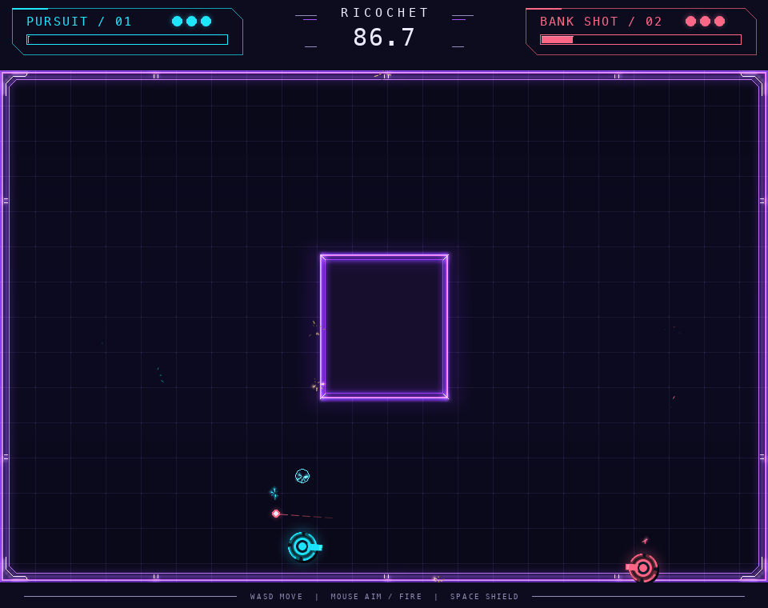
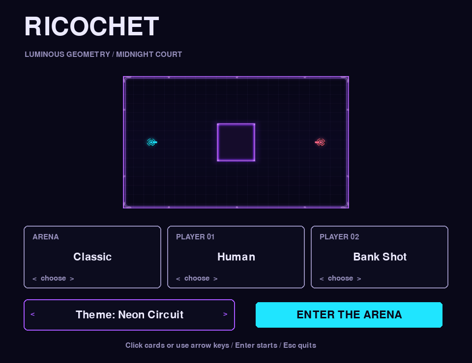
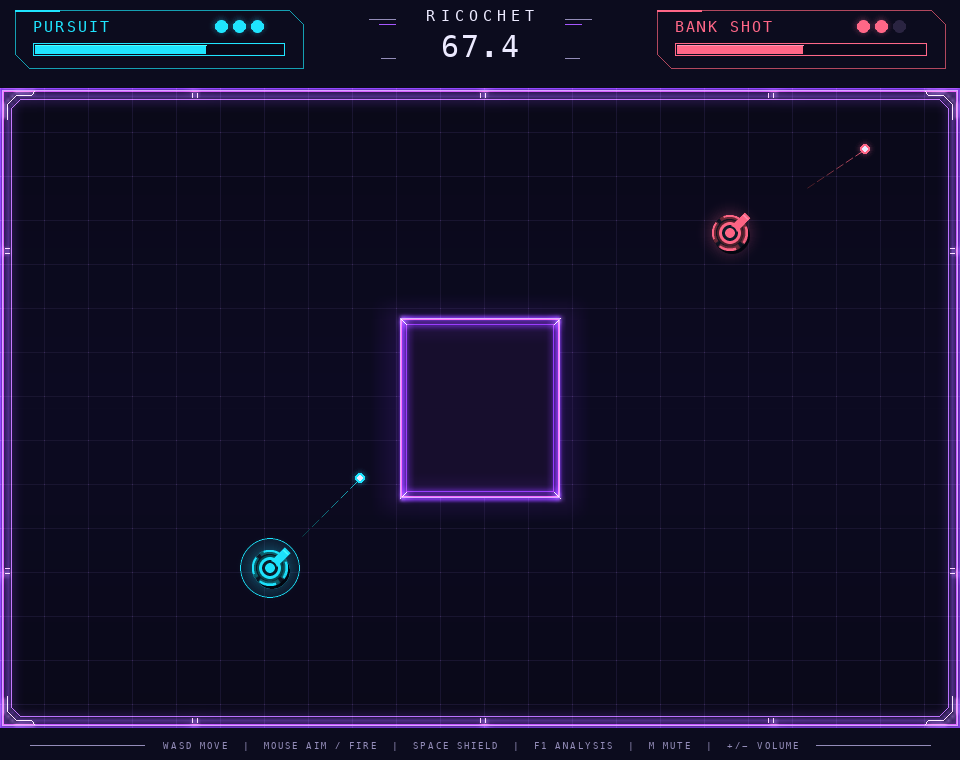
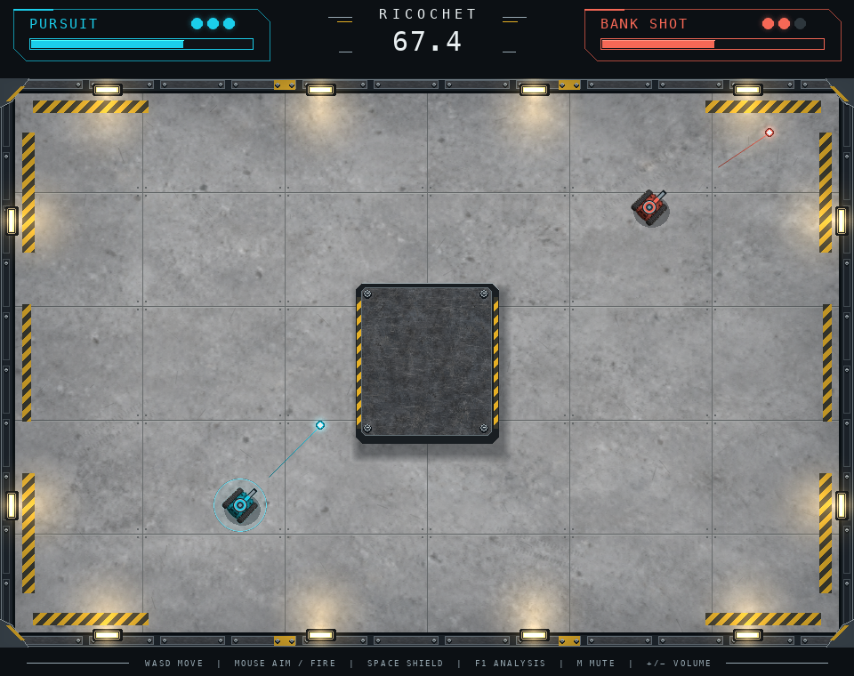

# Themes and presentation composition

Neon Circuit is the default theme. Select **Theme** in the menu with the mouse or arrow keys. The preview updates immediately. Robot League adds the concrete-and-steel style from the third proposal, with the same HUD layout as Neon Circuit. Selection survives rematches and returns to the menu within the current session; it is not saved across application restarts.

```sh
ricochet --theme neon-circuit
ricochet match --theme neon-circuit --p1 human --p2 bank_shot_ai
ricochet replay results/match.json --theme robot-league
```

## Boundaries

| Component | Owns |
| --- | --- |
| `game/` | Rules, physics, state and immutable snapshots |
| `runtime/` | Bot composition, matches and deterministic replays |
| `themes/` | Frozen theme definitions, semantic palette, style identifiers and catalog; standard library only |
| `display/styles/base.py` | `BaseStyle`: HUD and footer layout, the tank pipeline (shield, commitment arc, hit flash, analysis outline) and drawing helpers shared by every theme |
| `display/styles/<theme>.py` | One subclass per look: floor, walls, machine body, projectiles, trails and sparks, with that look's material colors named on the class |
| `display/controls.py` | Key and mouse bindings and the footer hint that describes them |
| `display/renderer.py` | Frame composition, interpolation, transient effects, viewport and presentation |
| `display/app.py` | Composition of engine, bots, renderer and selected theme |

The renderer accepts a theme ID or a `Theme` value. A theme does not access the engine or change a tank's collision radius. The engine, bots and training code do not import themes. CLI discovery imports only the dependency-free catalog, so core-only headless installations still work. Replays contain simulation state, not presentation preferences: any recording can be viewed with any theme without changing its hashes.

The menu uses the same floor/tank strategy as gameplay. Static floors and small glow surfaces are cached. Analysis mode suppresses glow and shows the physical tank radius. Result screens and resized windows retain the selected theme and single-frame presentation.

## Colors

A color lives in exactly one place. The `Theme` palette holds the semantic colors that shared code draws with: background, panel, text, muted, players, accent, energy, inactive and shield. The HUD, menu, renderer effects and shield overlays use only these. Colors that describe one look (concrete joints, bolt faces, neon grid lines) are named constants at the top of that style class, never anonymous literals in drawing code. Where a material should follow the palette, the style reads it from the theme. Robot League's hazard paint, for example, is the theme accent.

## Adding a theme

1. Add a frozen `Theme` definition and register it in `themes/__init__.py`. Reuse an existing `arena_style` for a palette-only variant. The menu and CLI discover it automatically.
2. For a different look, subclass `BaseStyle` in a new `display/styles/<theme>.py` and register it in `STYLES` in `display/styles/__init__.py`. Only `floor(snapshot)` and `tank_body(sprite, tank, radius, color, recoil)` are required. Optional hooks: `tank_underlay` (glow or shadow), `muzzle_flash`, `wreck`, `shield_color`, `projectile`, `trail` and `particle`. HUD, footer and the shield/hit/analysis overlays come from the base class, so every theme presents the same information in the same layout. Keep the passed snapshot read-only and draw tanks at the interpolated position provided by the renderer.
3. Add visual checks across all maps, shields, shots, results and resizing. Keep art inside the logical arena; do not bake the concept image into a fixed map background.

For another game, reuse this composition pattern and semantic theme data. Its own renderer supplies game-specific drawing strategies (a graph game has nodes and edges rather than tanks). This is currently a Ricochet package boundary, not an extracted multi-game framework. A future non-Pygame renderer can interpret the same theme definitions with its own style implementation.

Neon Circuit is a procedural adaptation of the first visual proposal: midnight grid, violet edged obstacles, cyan/coral segmented robots, bounded glow, colored energy bars and angular HUD panels. No generated bitmap assets are required at runtime.




## Proposal fidelity pass

Neon Circuit now owns its complete HUD/footer layout as well as its arena and sprites: tracked monospace labels, centered title/timer, round health lights, outlined energy bars, chamfered border details, cached multiscale bloom and supersampled tank bodies. Trails and spark drawing are style methods too. Fonts use a system monospace fallback list; exact glyphs may differ across platforms.

For a reproducible comparison, run `PYTHONPATH=src .venv/bin/python scripts/capture_theme_preview.py`. The screenshots below use the real renderer and Classic map, with explicitly staged tank positions, health, energy and projectiles. They are visual fixtures, not evidence of a simulated match. Actual map proportions and collision sizes are preserved, so the generated proposal is not copied pixel for pixel.




## Robot League

Choose **Theme: Robot League** in the menu, or launch:

```sh
ricochet --theme robot-league
ricochet match --theme robot-league --p1 human --p2 bank_shot_ai
ricochet replay results/match.json --theme robot-league
```

`BaseStyle` owns HUD and footer layout for both themes, including health lights, full-width energy bars and centered title/timer. Robot League supplies its own palette, and its `display/styles/robot_league.py` style supplies concrete tiles, metal rails, hazard paint, lights, beveled steel walls, soft shadows and tracked machines. The chassis turns with movement; the turret aims independently. Shields, recoil, hits, destroyed tanks, replay controls and analysis mode remain supported.

Concrete, steel and the neutral chassis are bundled package assets under `data/themes/robot_league/`. Runtime tinting produces the two team colors while keeping the rubber tracks dark. Assets were generated with built-in imagegen; exact prompts are in [asset provenance](../src/ricochet/data/themes/robot_league/PROVENANCE.md). Floors and material loads are cached; no network or image generation is needed to play. No NumPy dependency was added.


